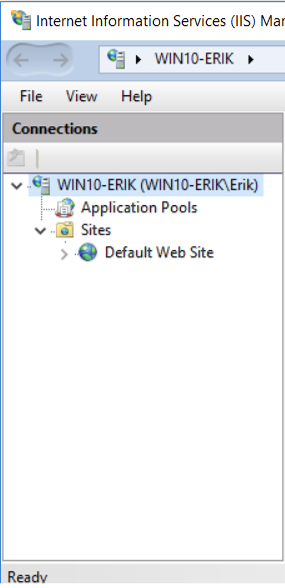
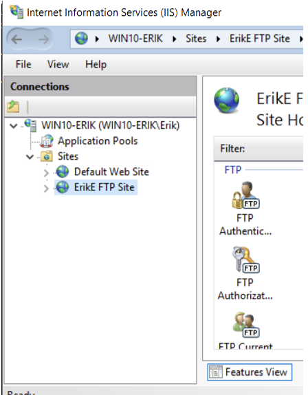
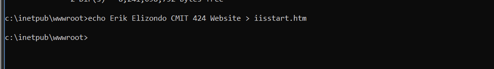
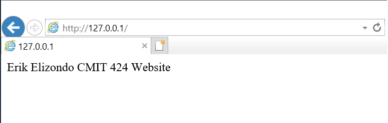
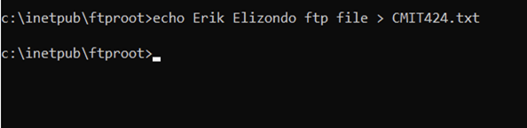
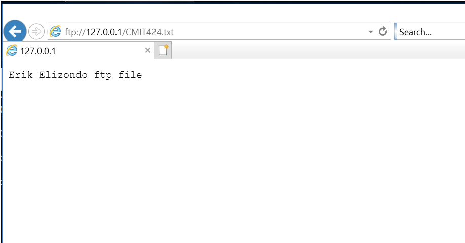
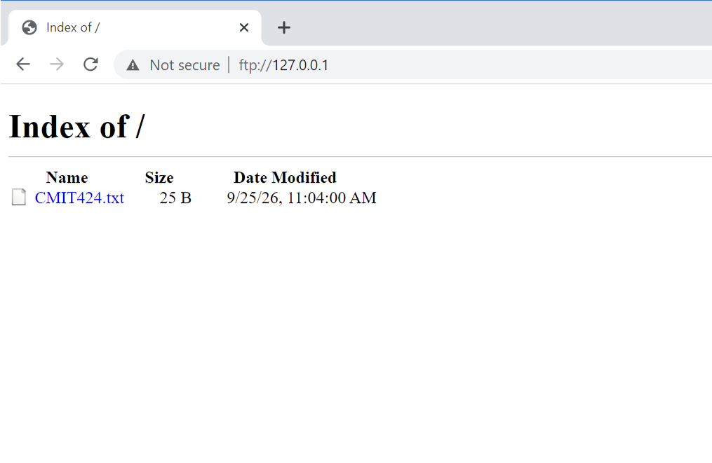
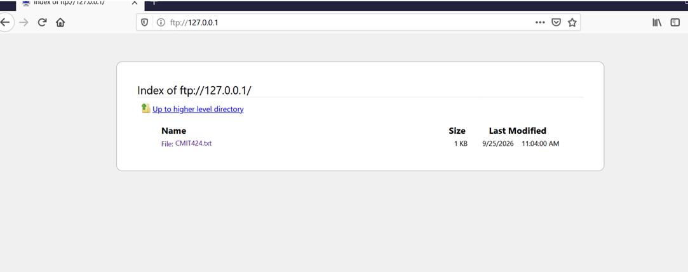

# Browser Artifact Analysis

## Overview

This investigation examines browser and web activity artifacts generated within a controlled Windows environment. Web and FTP services were configured locally, activity was intentionally generated across multiple browsers, and the resulting evidence was examined to better understand how user activity can be reconstructed during a forensic investigation.

The exercise demonstrates an important DFIR principle: actions performed through a web browser can leave artifacts that help establish what resources were accessed and how activity occurred across different applications.

---

## Objectives

- Configure local web and FTP resources to generate known activity
- Access controlled resources through multiple web browsers
- Examine differences in browser behavior when accessing those resources
- Establish known activity that can be compared against recovered browser artifacts
- Practice reconstructing user activity from multiple sources of evidence

---

## Environment & Tools

The investigation used a Windows lab environment with:

- Internet Information Services (IIS)
- FTP services
- Internet Explorer
- Google Chrome
- Mozilla Firefox
- Command-line utilities

The environment was intentionally configured to generate known browser activity for subsequent forensic examination.

---

## Investigation

### 1. Web Service Configuration

Internet Information Services was configured to provide a controlled web resource. Establishing a known local resource provided a predictable destination against which browser activity could be generated and later evaluated.

*Figure 1. IIS configuration used to establish the controlled web environment.*

---

### 2. FTP Service Configuration

An FTP resource was also configured within the lab environment. This created an additional source of network activity and provided an opportunity to observe how different browsers interacted with the same type of resource.

*Figure 2. FTP service configuration within the controlled environment.*

---

### 3. Web Content Creation

Test web content was created to provide a recognizable resource for browser access.

*Figure 3. Creation of controlled web content used during browser testing.*

---

### 4. Internet Explorer Web Access

The locally hosted webpage was accessed using Internet Explorer. Because the expected destination was known beforehand, this activity established a reference point for later artifact analysis.

*Figure 4. Verification of access to the controlled webpage using Internet Explorer.*

---

### 5. FTP Content Creation

Test content was created for the FTP resource so that subsequent access could be intentionally generated and observed.

*Figure 5. Creation of controlled content for FTP access testing.*

---

### 6. FTP Access with Internet Explorer

The FTP resource was accessed using Internet Explorer to establish known FTP-related browser activity.

*Figure 6. Internet Explorer accessing the configured FTP resource.*

---

### 7. FTP Access with Google Chrome

The same FTP resource was tested using Google Chrome. Using multiple browsers allowed browser behavior to be compared against the same controlled resource.

*Figure 7. FTP access testing using Google Chrome.*

---

### 8. FTP Access with Mozilla Firefox

Mozilla Firefox was also used against the controlled FTP resource, providing another browser-specific source of activity for comparison.

*Figure 8. FTP access testing using Mozilla Firefox.*

---

## Findings

The controlled activity demonstrated that browser-based investigations should not rely on a single application or artifact source. The same resource can be interacted with differently depending on the browser being examined.

Because the activity in this environment was intentionally generated, the expected web and FTP interactions provided a known baseline against which forensic artifacts could be evaluated.

Key observations from the investigation included:

- Web and FTP activity was successfully generated within the controlled environment.
- Multiple browsers were used against common resources, allowing their behavior to be compared.
- Browser activity is only one component of the investigative picture and benefits from correlation with other host and network artifacts.
- Establishing known activity before analysis provides a useful way to validate whether forensic tools and artifacts accurately reconstruct user behavior.

---

## Investigative Takeaways

One of the most useful aspects of this exercise was seeing that similar user actions do not necessarily produce identical behavior across browsers. Browser version, protocol support, and application behavior can influence both what the user experiences and what evidence may ultimately be available to an examiner.

For a forensic analyst, this reinforces the importance of context. An artifact should not be interpreted in isolation. Browser evidence becomes more meaningful when it can be correlated with system activity, network resources, timestamps, and other host-based evidence.

---

## Skills Demonstrated

- Browser artifact analysis
- Web activity reconstruction
- FTP activity analysis
- Cross-browser comparison
- IIS and FTP environment configuration
- Evidence correlation
- Forensic documentation

---

## Related Investigations

Return to the [ResidualEvidence investigation index](../../README.md).
