# Evidence Validation & Disk Analysis

## Overview

This investigation focuses on the preparation, acquisition, validation, and examination of digital evidence stored on disk. The work combines multiple forensic tasks into a single workflow, beginning with hash verification and storage preparation before progressing into forensic imaging, evidence integrity validation, analysis, and file recovery.

A central theme of the investigation is evidence integrity. Hash values were generated with multiple tools and used throughout the acquisition process to demonstrate how an examiner can establish that evidence remains consistent as it moves from collection into analysis.

---

## Objectives

- Generate and compare cryptographic hash values using multiple tools
- Prepare storage volumes for forensic acquisition and analysis
- Create and configure forensic evidence images
- Verify image integrity through hash comparison
- Examine acquired evidence using Autopsy
- Identify artifacts within a forensic image
- Recover data through file carving
- Document a repeatable evidence-handling workflow

---

## Tools & Environment

The investigation used a Windows lab environment and several forensic utilities:

- FTK Imager
- Autopsy
- HashTab
- Sigcheck
- HashCalc
- Windows Disk Management
- Command-line utilities

---

# Phase 1: Evidence Validation & Storage Preparation

## 1. File Hash Verification with HashTab

HashTab was used to generate cryptographic hash values for a known file. This established an initial reference for examining how different utilities represent and verify the same underlying evidence.

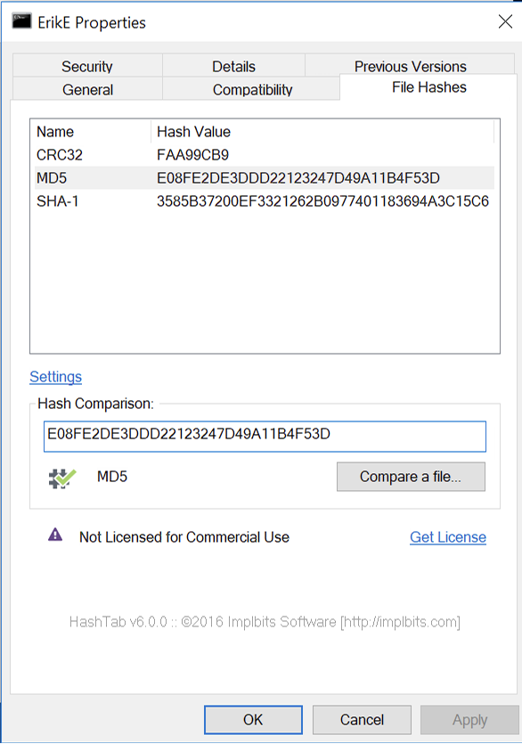

*Figure 1. Cryptographic hash values generated using HashTab.*

---

## 2. Independent Verification with Sigcheck

The same evidence was examined using Sigcheck, providing a second method for calculating and comparing file hashes.

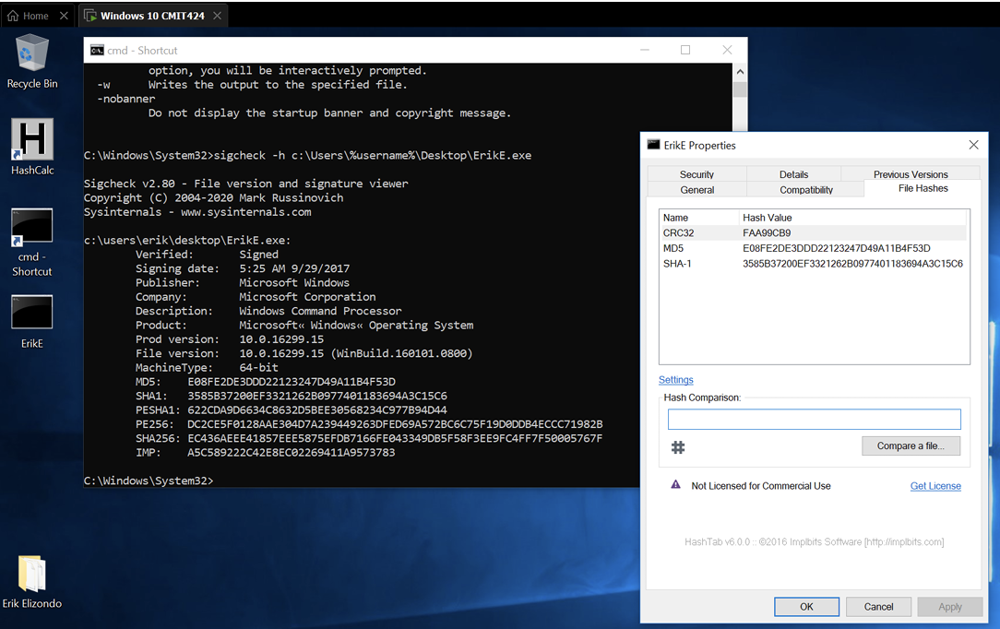

*Figure 2. Independent hash verification using Sigcheck.*

---

## 3. Independent Verification with HashCalc

HashCalc provided an additional method of calculating hash values, allowing results from multiple tools to be compared.

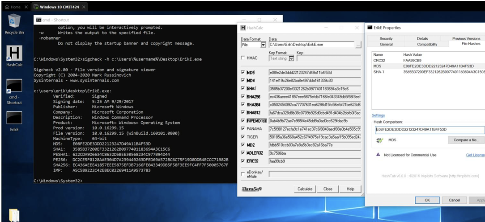

*Figure 3. Hash calculation performed using HashCalc.*

### Observation

Using multiple utilities reinforced that evidence verification is based on the resulting hash value rather than dependence on a particular forensic application. Consistent results provide a method of checking whether the underlying data remained unchanged between examinations.

---

# Phase 2: Storage Preparation

## 4. Primary Volume Identification

The primary system volume was identified and labeled as part of preparing the environment for subsequent forensic work.

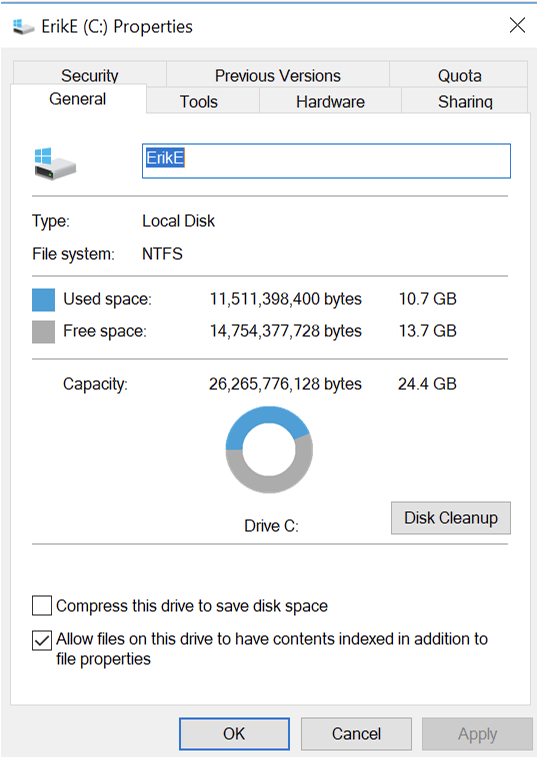

*Figure 4. Identification and labeling of the primary volume.*

---

## 5. Backup Volume Configuration

A separate volume was prepared for backup and evidence-handling activities.

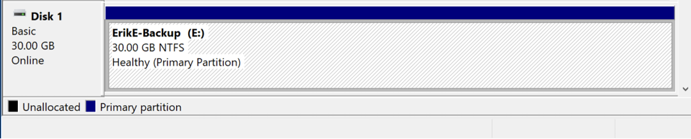

*Figure 5. Configuration of the secondary storage volume.*

---

## 6. Disk Layout Verification

Windows Disk Management was used to review the configured storage environment and verify the available volumes.

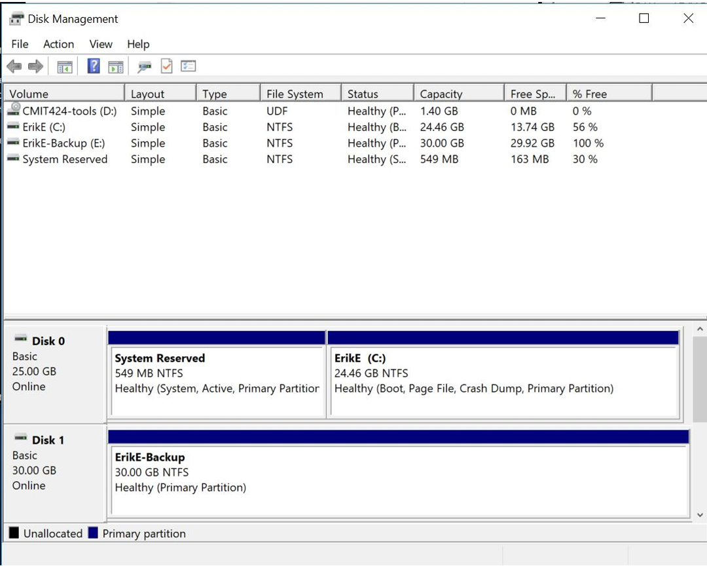

*Figure 6. Disk Management view of the configured storage environment.*

---

# Phase 3: Forensic Image Verification

## 7. Forensic Image Hash Verification

The forensic image was subjected to integrity verification using cryptographic hashes. Hash comparison provides a repeatable method for determining whether evidence has changed between acquisition and examination.

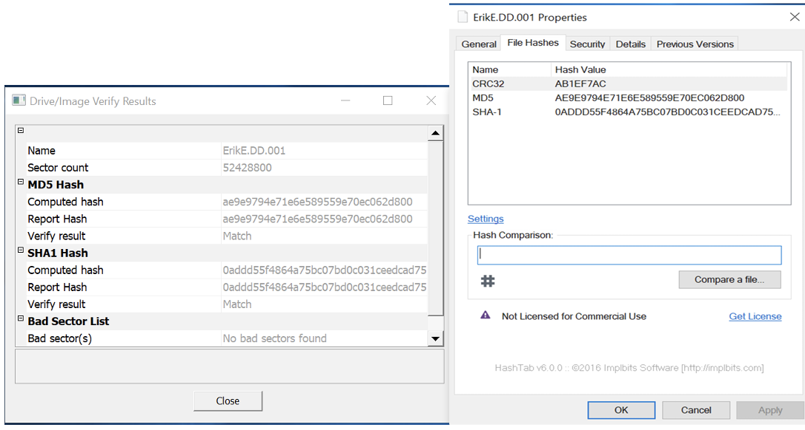

*Figure 7. Hash verification of the forensic image.*

---

# Phase 4: Disk Acquisition

## 8. Evidence Volume Creation

A new volume was prepared through the Windows volume creation process for the next stage of the forensic workflow.

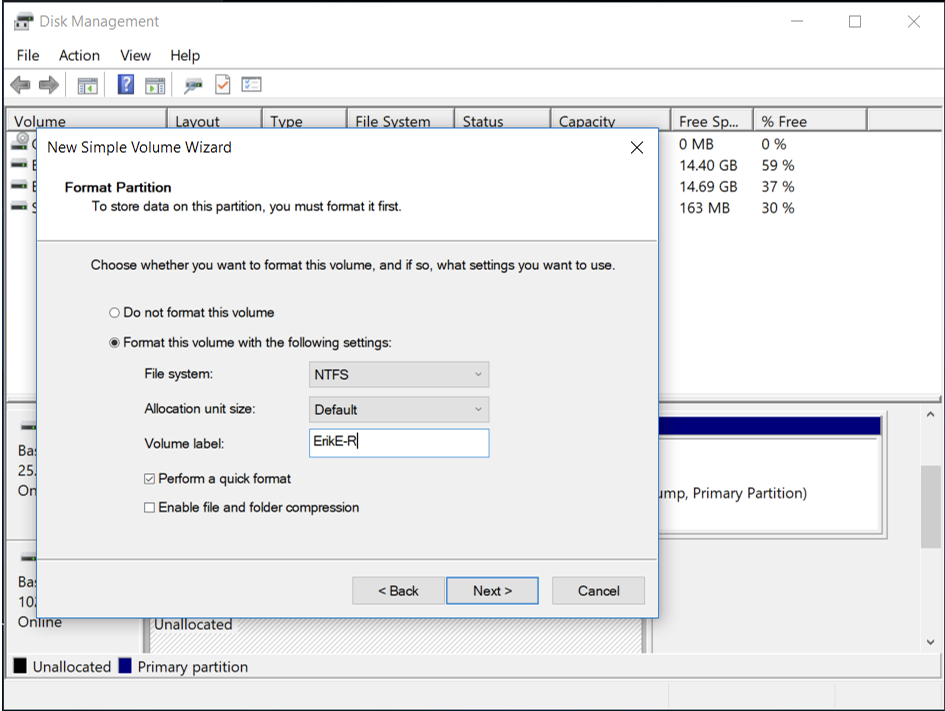

*Figure 8. Windows volume creation wizard used during environment preparation.*

---

## 9. Disk Configuration Review

The resulting disk configuration was reviewed using Disk Management before proceeding with imaging.

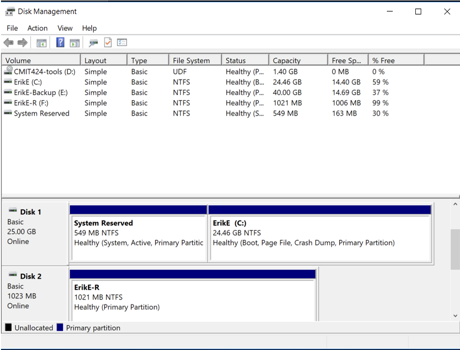

*Figure 9. Review of disk and volume configuration before acquisition.*

---

## 10. FTK Imager Evidence Configuration

FTK Imager was configured with the evidence source required for forensic acquisition.

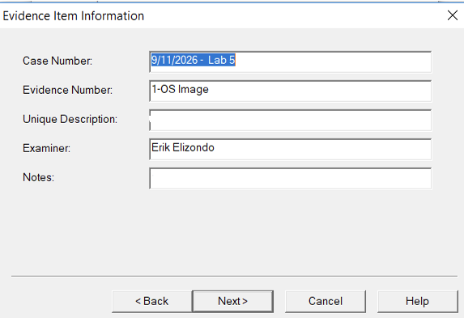

*Figure 10. Evidence source configuration within FTK Imager.*

---

# Phase 5: Acquisition Integrity Verification

## 11. Operating System Image Verification

Hash values associated with the operating system image were reviewed as part of validating the forensic acquisition.

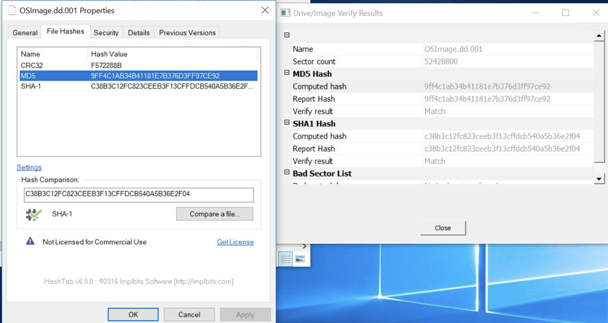

*Figure 11. Cryptographic hash verification for the acquired operating system image.*

---

## 12. Secondary Image Verification

A second acquired image was also subjected to hash verification, reinforcing integrity validation as part of the acquisition workflow.

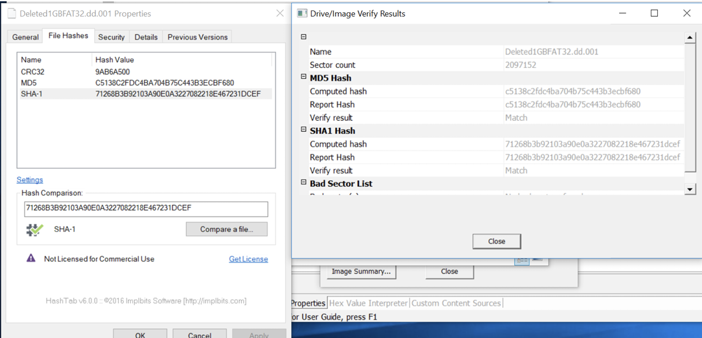

*Figure 12. Hash verification results for an additional forensic image.*

---

# Phase 6: Forensic Examination

## 13. Autopsy Case Configuration

The acquired evidence was introduced into Autopsy for examination. Creating a dedicated case provides an organized environment for analyzing the contents of forensic images and recovered artifacts.

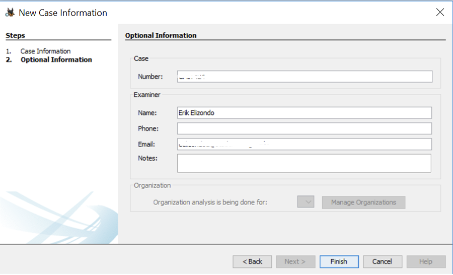

*Figure 13. Forensic case configuration within Autopsy.*

---

## 14. Artifact Examination

An `ls.bat` artifact within the evidence was identified and examined during analysis.

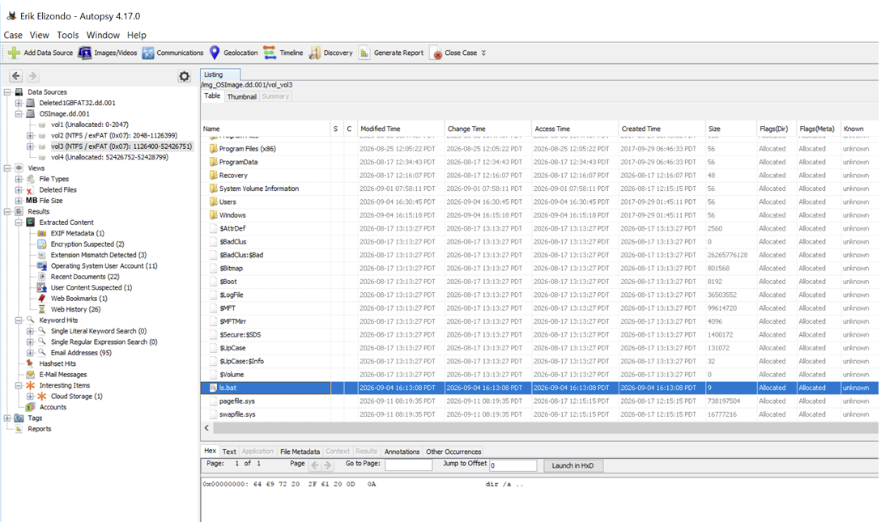

*Figure 14. Examination of the ls.bat artifact within the forensic image.*

---

## 15. File Carving and Recovery

The investigation concluded with the recovery of image data through file carving. This demonstrated that useful evidence may remain recoverable even when it is no longer represented through ordinary file-system access.

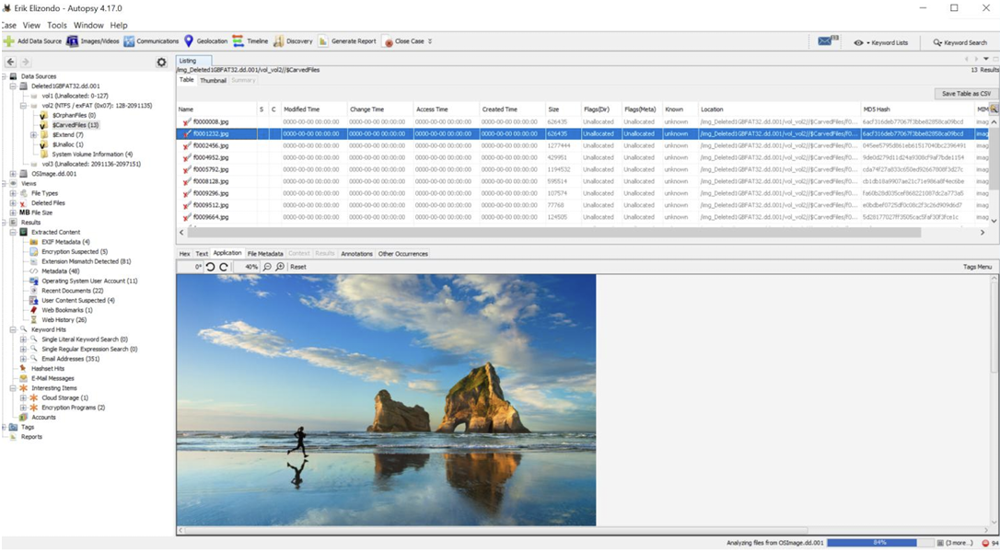

*Figure 15. Image artifact recovered through file carving.*

---

# Findings

The investigation demonstrated a complete evidence-handling workflow spanning preparation, acquisition, validation, analysis, and recovery.

Key observations included:

- Cryptographic hashes could be generated and compared using multiple independent utilities.
- Storage preparation and identification were important preliminary steps before acquisition.
- Forensic images could be validated through hash comparison before proceeding with analysis.
- FTK Imager provided the acquisition component of the workflow, while Autopsy provided an environment for examining the resulting evidence.
- Artifacts within a forensic image could be identified and examined independently of the original operating environment.
- File carving demonstrated that recoverable evidence can persist outside normal file-system presentation.

---

# Investigative Takeaways

This investigation reinforced that forensic analysis begins before an examiner starts searching for artifacts. Evidence must first be identified, acquired, and validated in a way that allows subsequent findings to be tied back to a known evidence source.

Hashing was particularly important throughout the exercises because it provided a common method for checking evidence consistency across different tools and stages of analysis.

The file recovery portion also demonstrated an important principle of digital forensics: removing a file from normal user access does not necessarily mean the underlying data is immediately unavailable to forensic examination.

Together, these exercises established a workflow I can carry into future investigations:

**Prepare → Acquire → Validate → Analyze → Recover → Document**

---

# Skills Demonstrated

- Forensic disk imaging
- Evidence integrity verification
- Cryptographic hashing
- Cross-tool hash comparison
- Storage and volume preparation
- FTK Imager
- Autopsy
- File-system examination
- Artifact identification
- File carving and recovery
- Forensic documentation

---

## Related Investigations

[Return to ResidualEvidence](../../README.md)
