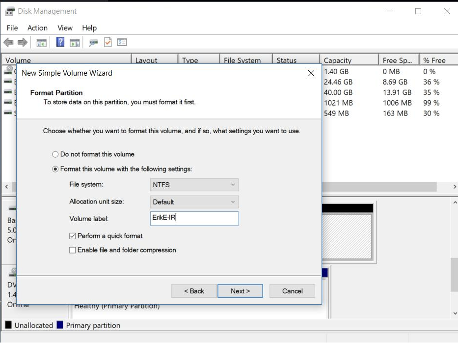
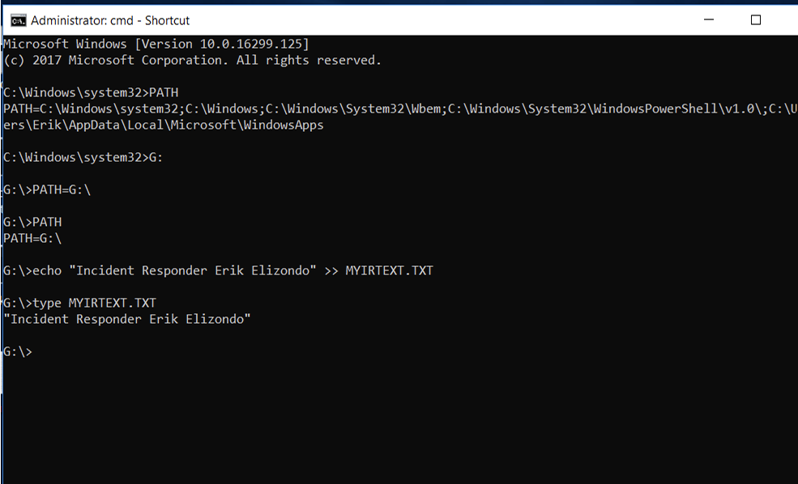
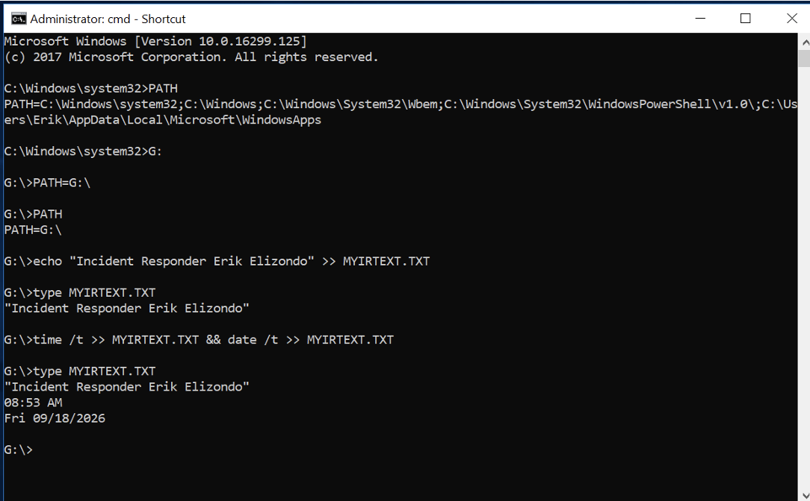
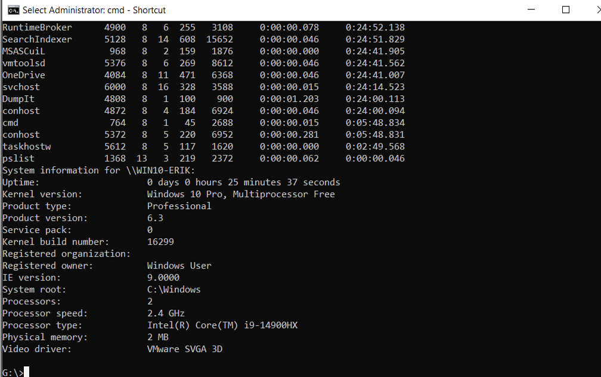
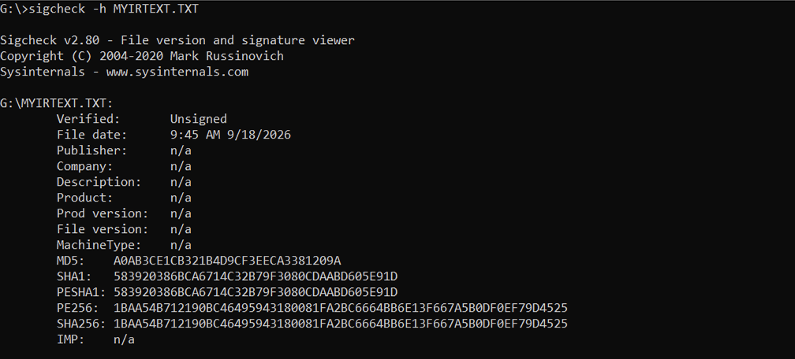
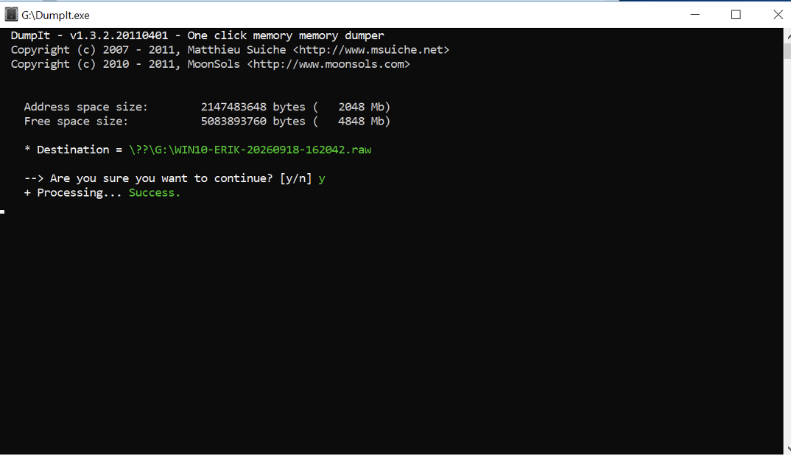
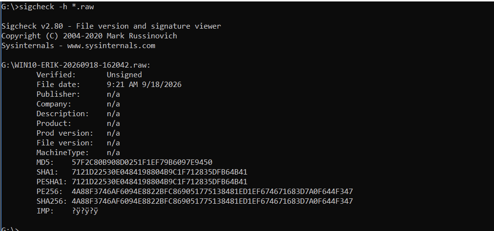
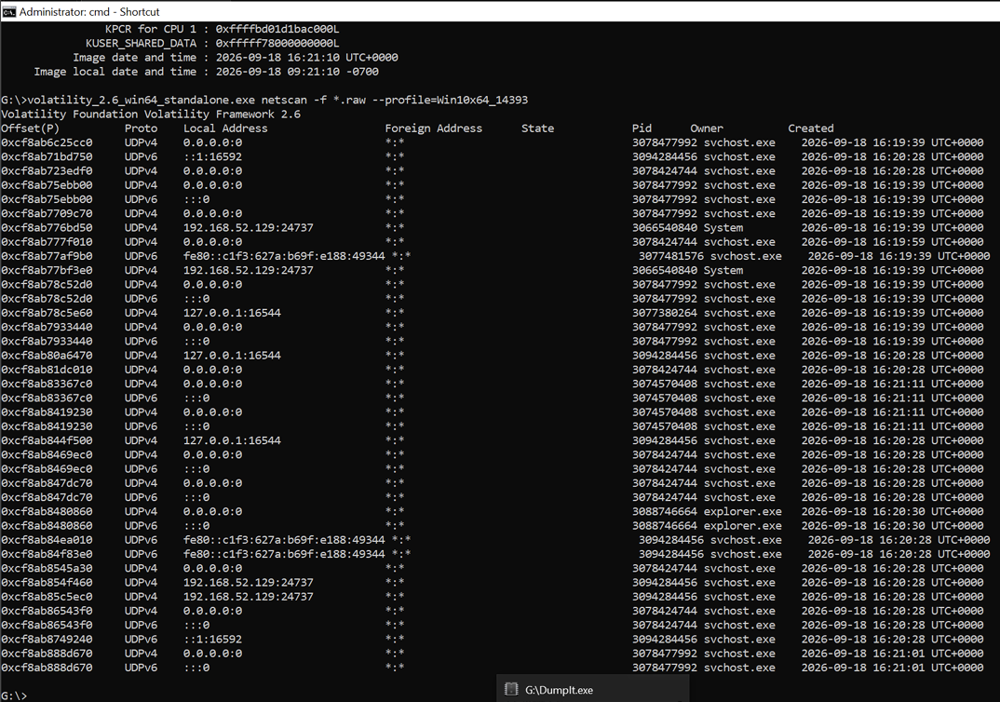

# Memory Forensics with Volatility

## Overview

This investigation focuses on the acquisition, preservation, validation, and analysis of volatile memory from a Windows system.

Unlike evidence stored on disk, volatile memory represents a point-in-time view of an active system and must be collected before that information is lost. The investigation follows the memory evidence lifecycle from preparation and system documentation through RAM acquisition, cryptographic verification, and network artifact analysis with Volatility.

The objective was not simply to create a memory dump, but to document a repeatable process for collecting volatile evidence while preserving enough context to support later analysis.

---

## Objectives

- Prepare dedicated storage for collected evidence
- Document the responder and collection time
- Record system information before acquisition
- Verify files involved in the collection process
- Acquire volatile memory using DumpIt
- Generate cryptographic hashes for the acquired memory image
- Analyze the memory image using Volatility
- Examine network artifacts recovered from volatile memory

---

## Tools & Environment

This investigation was performed in a controlled Windows lab environment using:

- DumpIt
- Volatility
- Sysinternals PsInfo
- Sigcheck
- Windows command-line utilities

---

# Phase 1: Evidence Preparation

## 1. Evidence Volume Identification

Before collecting volatile evidence, the destination volume was identified and labeled. Separating collected evidence from the source environment provided a clearly defined location for the resulting forensic data.

*Figure 1. Evidence volume identified prior to memory acquisition.*

---

## 2. Incident Responder Identification

Responder information was recorded as part of the collection process.

*Figure 2. Incident responder information documented within the collection environment.*

---

## 3. Collection Timestamp

The collection environment was documented with the date and time associated with evidence acquisition.

*Figure 3. Timestamp recorded during evidence collection.*

### Why This Matters

Memory captures represent system state at a particular point in time. Recording the collection context helps establish when that snapshot was obtained and provides information that can later be correlated with other forensic evidence.

---

# Phase 2: System Documentation

## 4. System Information Baseline

PsInfo was used to document information about the system prior to memory acquisition.

*Figure 4. System information collected prior to memory acquisition.*

Establishing basic information about the source system gives the acquired memory image additional investigative context and helps document the environment from which the evidence originated.

---

# Phase 3: Collection Tool Verification

## 5. File Hash Verification

Sigcheck was used to calculate cryptographic hashes associated with files used during the response process.

*Figure 5. Cryptographic hashes generated using Sigcheck.*

Hashing provides a reproducible identifier for a file and provides a method for detecting whether the contents of that file change later.

---

# Phase 4: Memory Acquisition

## 6. RAM Acquisition with DumpIt

DumpIt was used to capture the volatile memory of the Windows system.

*Figure 6. Volatile memory acquisition performed using DumpIt.*

Memory acquisition is particularly important because RAM can contain information associated with the active state of a system that will not persist indefinitely. Capturing memory allows that state to be preserved for later examination.

### Acquisition Challenge

One practical issue encountered during this exercise involved storage capacity. The initial memory configuration required more evidence-storage space than was available for the resulting dump.

The environment had to be adjusted so that the acquisition could be completed successfully.

This became an important operational lesson: **before beginning volatile evidence collection, verify that the destination has sufficient capacity for the acquired image.**

---

# Phase 5: Evidence Integrity Verification

## 7. Memory Image Hash Verification

After acquisition, cryptographic hashes were generated for the resulting memory image.

*Figure 7. Cryptographic hash values generated for the acquired memory image.*

These values provide a reference against which the image can be checked during later handling and analysis.

---

# Phase 6: Memory Analysis

## 8. Network Analysis with Volatility

The acquired memory image was examined with Volatility using network-oriented analysis.

*Figure 8. Network artifacts examined from the memory image using Volatility.*

Network-related structures present in memory can contribute to reconstruction of system activity by providing evidence associated with connections and network-enabled processes existing around the time of acquisition.

---

# Findings

The investigation successfully followed volatile evidence from acquisition preparation through forensic analysis.

Key observations included:

- Collection context was documented before memory acquisition.
- System information was recorded to provide context for the resulting evidence.
- Cryptographic hashing was incorporated into the evidence-handling workflow.
- A memory image was acquired using DumpIt.
- The acquired memory image was hashed after collection.
- Volatility was used to examine network-related artifacts contained within the memory image.
- Available storage must be considered before attempting RAM acquisition.

---

# Investigative Takeaways

This investigation demonstrated why memory forensics requires a different mindset from disk analysis. Volatile evidence cannot simply be revisited on the original system later with the expectation that the same information will still exist.

The acquisition process therefore matters just as much as the eventual analysis.

The storage problem encountered during acquisition was also useful from an investigative perspective. Tools and commands are only part of evidence collection. An examiner must also account for practical constraints such as destination capacity and ensure that the collection environment can support the evidence being acquired.

Finally, Volatility demonstrated how a captured memory image can be treated as an investigative dataset rather than simply an archive of RAM. Once preserved and validated, volatile evidence can be examined for artifacts that provide additional context about what the system was doing around the time of collection.

---

# Workflow

**Prepare → Document → Acquire → Validate → Analyze**

This workflow provides a repeatable foundation for future memory-forensics investigations.

---

# Skills Demonstrated

- Volatile evidence acquisition
- Memory forensics
- Evidence integrity verification
- Cryptographic hashing
- System documentation
- DumpIt
- Volatility
- Network artifact analysis
- Evidence handling
- Troubleshooting during acquisition
- Forensic documentation

---

## Related Investigations

[Return to ResidualEvidence](../../README.md)
