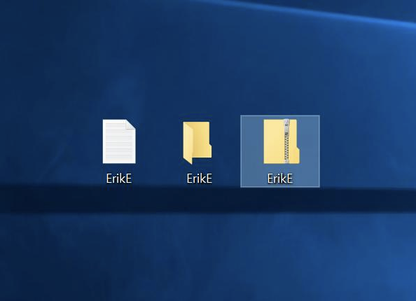
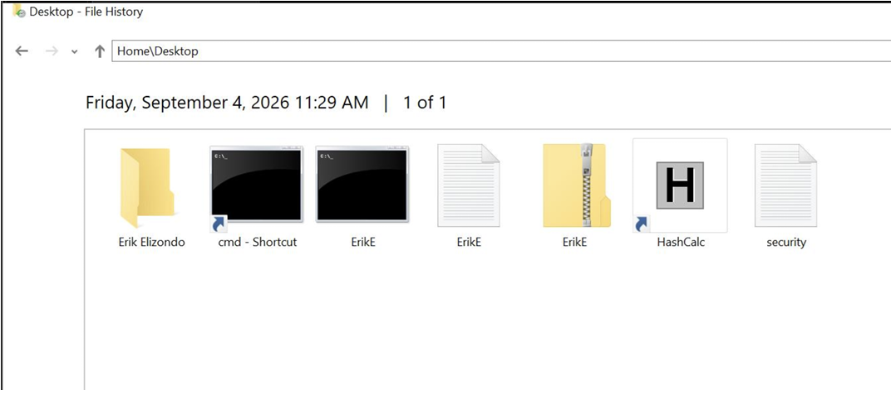
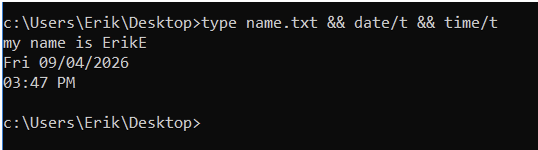
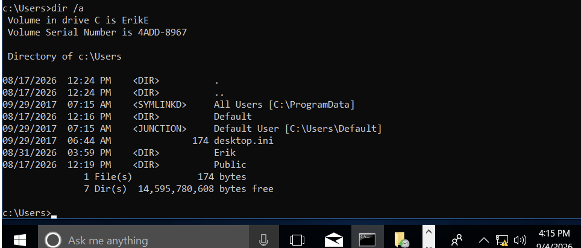
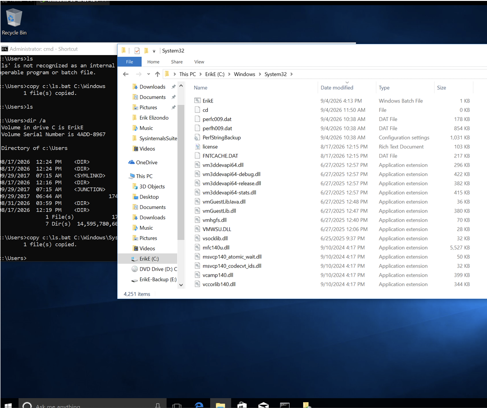
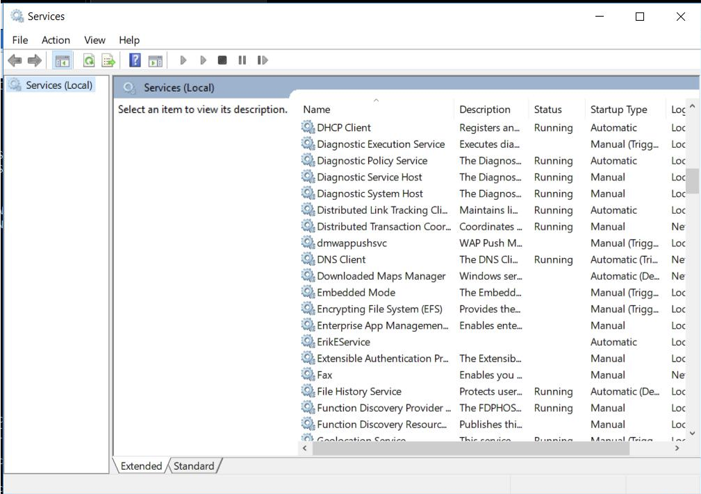
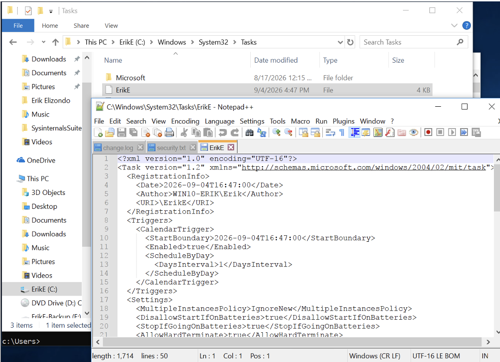
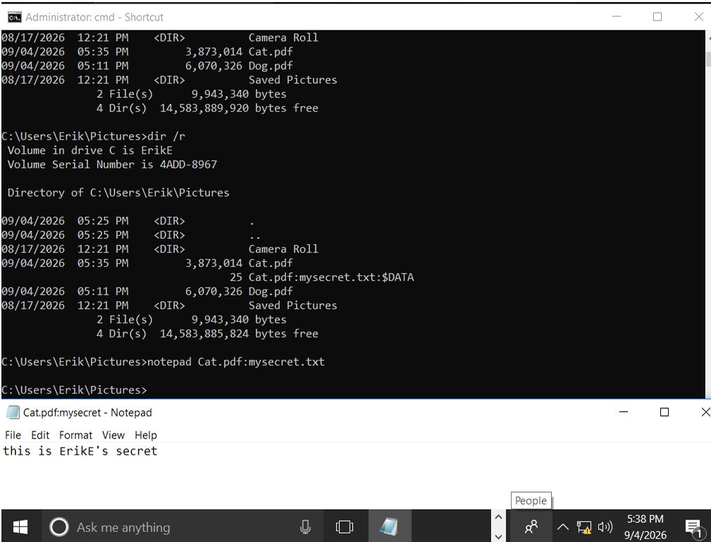

# Windows Artifact Analysis

## Overview

This investigation examines how common activity within a Windows environment can create, modify, preserve, and expose artifacts useful during forensic analysis.

The investigation intentionally generated known activity involving files, compressed archives, command-line operations, directories, Windows services, running applications, and File History. These artifacts were then examined to better understand how ordinary system and user activity can contribute to reconstruction of events during a forensic investigation.

Rather than treating a single artifact as definitive evidence, the exercise focuses on recognizing multiple sources of information and understanding how they can contribute to a larger investigative picture.

---

## Objectives

- Generate known file-system activity in a controlled Windows environment
- Examine file and archive artifacts
- Recover data through Windows File History
- Generate and inspect command-line activity
- Examine user and system directories
- Review Windows service information
- Observe running process and application information
- Identify user-created file artifacts
- Practice correlating different sources of Windows evidence

---

## Environment & Tools

This investigation was performed in a controlled Windows lab environment using:

- Windows File Explorer
- Windows File History
- Windows Command Prompt
- Windows Services
- Windows system directories
- Process and application inspection utilities

---

# Phase 1: File-System Activity

## 1. File and Archive Creation

Known file-system activity was generated by creating files, directories, and compressed content within the lab environment.

*Figure 1. Known file and archive activity generated within the Windows environment.*

Generating known activity provides a reference point for understanding how file operations are represented within the operating system and what may remain available during later examination.

---

# Phase 2: File Recovery

## 2. File History Recovery

Windows File History was examined as a source for recovering previously preserved file contents.

*Figure 2. File recovery performed through Windows File History.*

### Investigative Value

Recovery mechanisms can provide another source of evidence when the contents currently visible to the user do not represent the complete history of a file.

Forensic examination therefore benefits from looking beyond the live contents of a directory and considering additional locations where prior data may exist.

---

# Phase 3: Command-Line Activity

## 3. Command-Line File Generation

The Windows command line was used to generate known file activity.

*Figure 3. Known file activity generated through the Windows command line.*

This demonstrates that useful investigative context can come from understanding not only which files exist, but also the actions used to create or manipulate them.

---

# Phase 4: Directory Examination

## 4. User Directory Enumeration

The contents of the user directory were enumerated from the command line.

*Figure 4. Command-line enumeration of a Windows user directory.*

Directory examination can assist with identifying user-accessible files and establishing the location of artifacts relevant to an investigation.

---

## 5. System32 Directory Examination

The Windows System32 directory was also examined as part of the system review.

*Figure 5. Examination of the Windows System32 directory.*

System directories contain operating-system components and should be distinguished from locations commonly associated with user-generated data.

---

# Phase 5: Windows Service Examination

## 6. Service Analysis

Windows Services was used to examine a configured service within the environment.

*Figure 6. Examination of a Windows service through the Services interface.*

Services represent another source of system-state information that may become relevant when reconstructing activity on a Windows host.

The presence of a service alone does not determine whether activity is benign or suspicious. Its investigative value depends on the surrounding evidence and context.

---

# Phase 6: Process and Application Review

## 7. Active Application Review

Running activity was reviewed to observe applications and processes present within the Windows environment.

*Figure 7. Review of active process and application information.*

Examining active applications provides another perspective on system state and can help correlate activity observed through other evidence sources.

---

# Phase 7: User-Created Artifact Examination

## 8. File Artifact Identification

A deliberately created file was examined as a known user-generated artifact.

*Figure 8. Known user-created file artifact within the lab environment.*

Because the artifact was intentionally generated, the expected activity could be compared with information observed elsewhere in the environment.

---

# Findings

This investigation demonstrated how several independent areas of Windows can contribute evidence relevant to reconstructing activity.

Key observations included:

- File creation and compression produced identifiable file-system activity.
- Windows File History provided an additional location from which file contents could be recovered.
- Command-line activity could be used to create and enumerate files and directories.
- User and system directories provided different categories of potentially relevant artifacts.
- Windows services represented another source of system-state information.
- Process and application review provided additional context about activity present on the system.
- Known user-created artifacts provided reference points that could be compared against other system evidence.

---

# Investigative Takeaways

The most important takeaway from this investigation is that Windows evidence is distributed.

A forensic examiner may need to consider information from file systems, recovery mechanisms, command-line activity, system directories, services, and active applications rather than expecting a single artifact to explain what occurred.

The exercise also reinforced the value of generating known activity in a controlled environment. When the original action is already known, the artifacts created by that action can be examined directly. That makes controlled labs useful for learning how different types of Windows activity may appear during a future investigation.

At the same time, the existence of an artifact should not automatically be treated as proof of intent or malicious behavior. Context and correlation remain necessary before drawing conclusions.

---

# Workflow

**Generate → Observe → Recover → Examine → Correlate → Document**

---

# Skills Demonstrated

- Windows artifact analysis
- File-system examination
- File recovery
- Windows File History
- Command-line analysis
- Directory enumeration
- Windows service examination
- Process and application review
- Artifact correlation
- Forensic documentation

---

## Related Investigations

../../README.md
