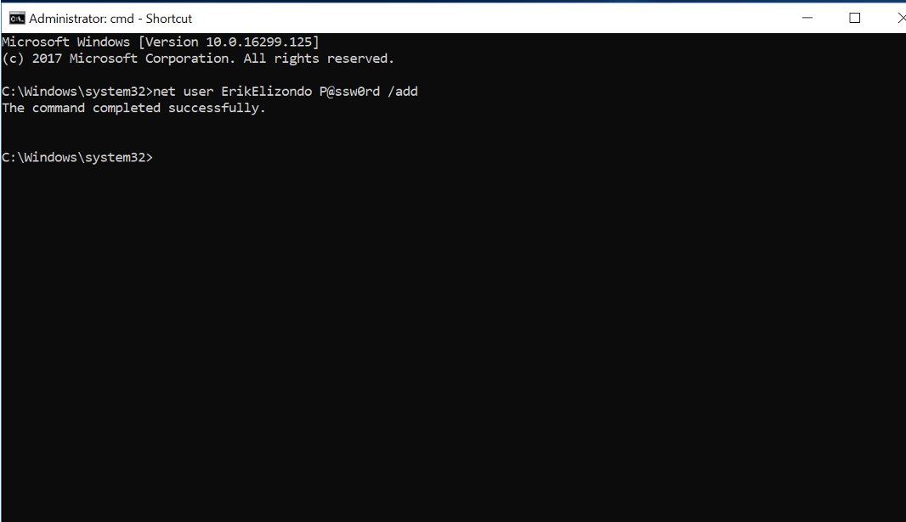
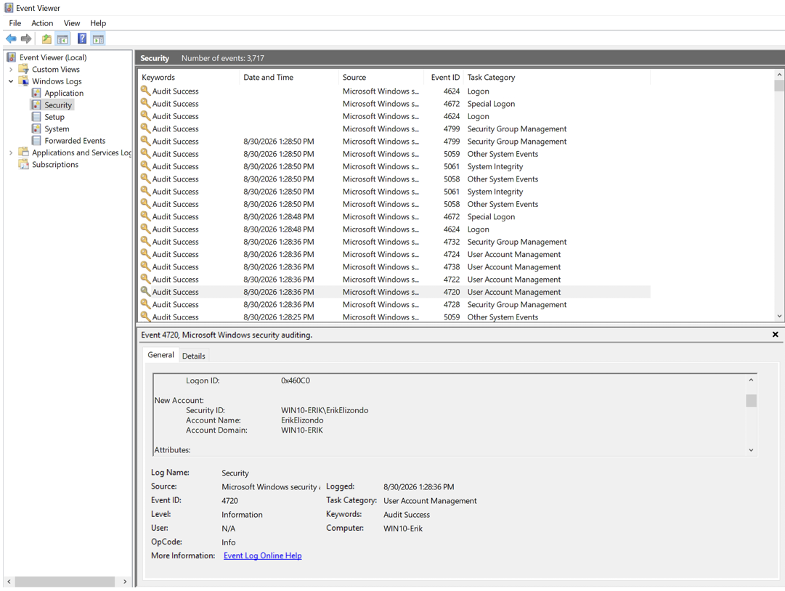
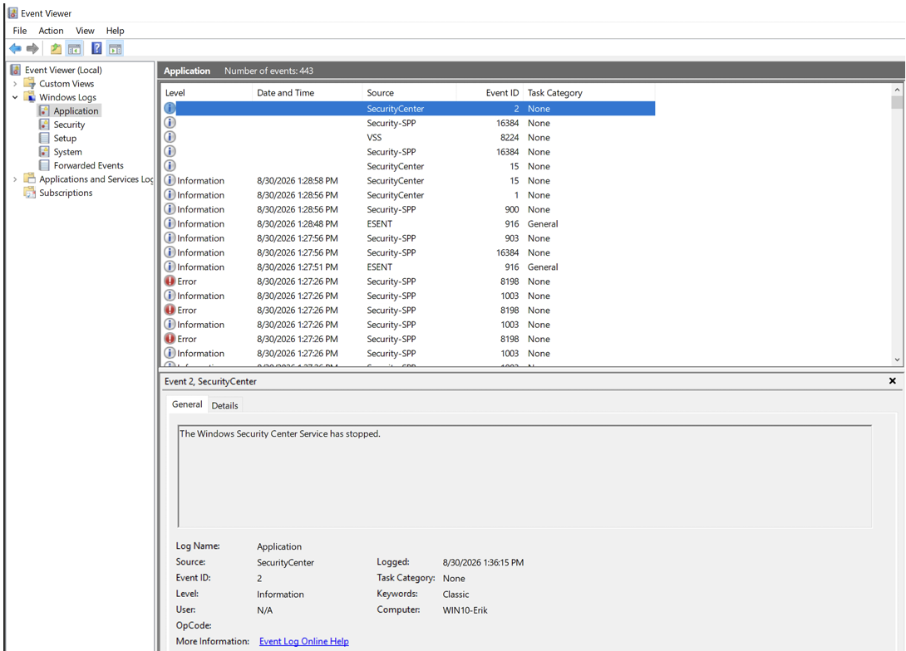
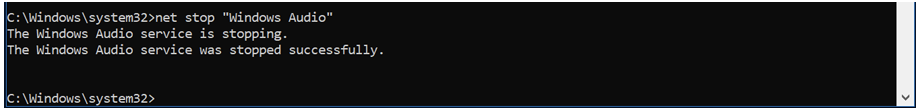
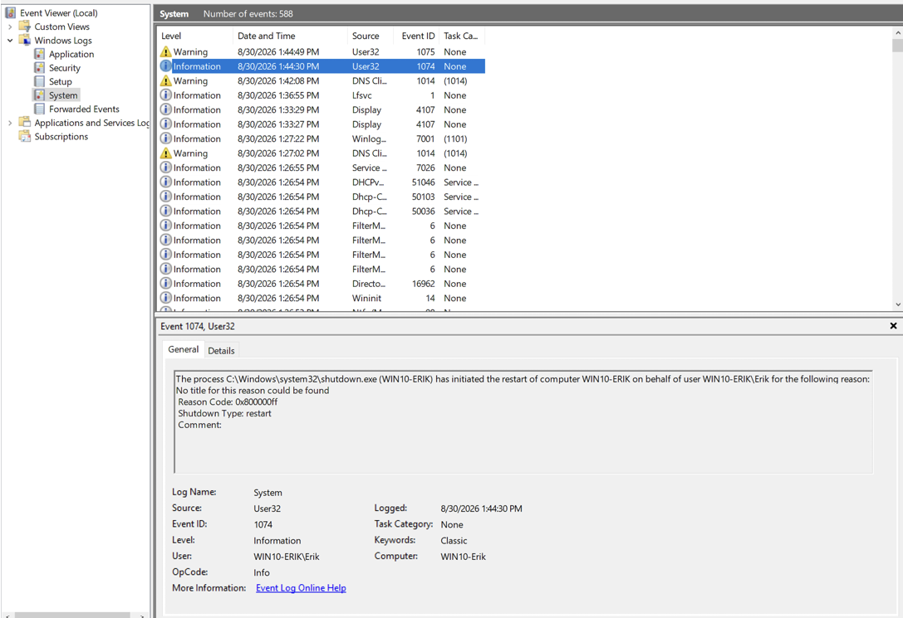
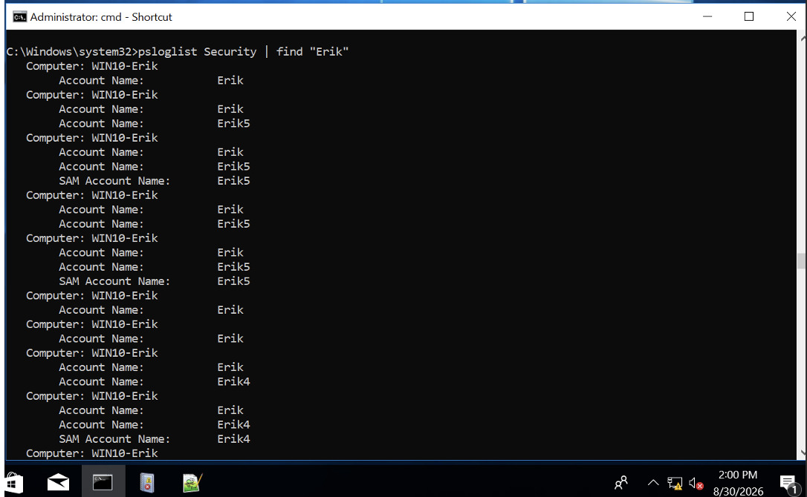
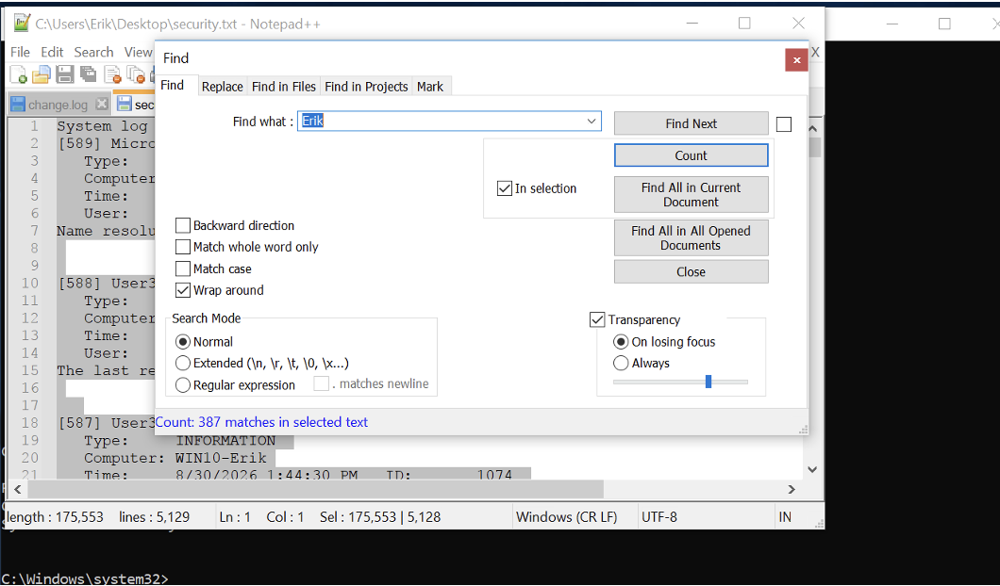
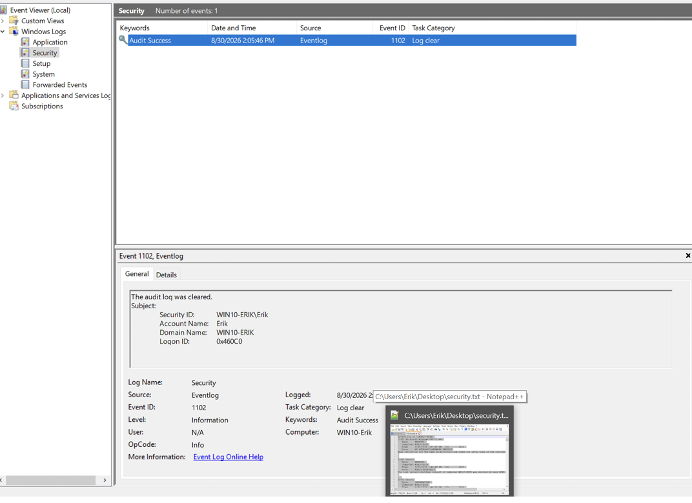

# Windows Event Log Investigation

## Overview

This investigation examines Windows Event Logs as a source of forensic evidence for reconstructing system activity.

Known activity was intentionally generated within a controlled Windows environment, including creation of a user account, interaction with a Windows service, and a system shutdown. Windows Security, Application, and System logs were then examined to identify records associated with that activity.

The investigation also explored multiple approaches to reviewing event data and concluded by examining log clearing as an action that can affect the availability of historical evidence.

---

## Objectives

- Generate known Windows activity for later examination
- Examine Security, Application, and System event logs
- Identify events associated with system and user activity
- Review service-related and shutdown events
- Examine event data using multiple methods
- Practice correlating known actions with recorded events
- Observe the effect of clearing Windows event logs
- Develop a repeatable approach to event-log analysis

---

## Environment & Tools

This investigation was performed in a controlled Windows lab environment using:

- Windows Event Viewer
- Windows Command Prompt
- PsLogList
- Notepad++
- Windows Security, Application, and System logs

---

# Phase 1: Known Activity Generation

## 1. User Account Creation

A user account was created from the Windows command line to generate known activity that could later be compared against Windows event data.

*Figure 1. User account creation within the controlled Windows environment.*

Generating an action with a known cause provides a useful reference when learning how Windows represents activity within its logs.

---

# Phase 2: Event Log Examination

## 2. Security Event Log

The Windows Security log was examined following the generation of known user activity.

*Figure 2. Windows Security event data reviewed through Event Viewer.*

Security events can contribute evidence related to account and authentication activity when reconstructing events on a Windows system.

---

## 3. Application Event Log

The Application log was also reviewed as an independent source of Windows event information.

*Figure 3. Windows Application event data examined through Event Viewer.*

Examining multiple log sources reinforces that Windows activity is distributed across different event channels rather than captured within a single universal log.

---

# Phase 3: Service Activity

## 4. Windows Audio Service Termination

Known service activity was generated by stopping the Windows Audio service.

*Figure 4. Controlled termination of the Windows Audio service.*

Generating a known service event provided another action that could be compared against subsequently recorded system events.

---

# Phase 4: System Activity

## 5. Shutdown Event Examination

Windows System event data was examined in connection with system shutdown activity.

*Figure 5. System event information associated with shutdown activity.*

System events can provide valuable temporal reference points when reconstructing what occurred before, during, or after other activity observed on a host.

---

# Phase 5: Alternative Log Examination

## 6. Event Parsing with PsLogList

Event data was examined from the command line using PsLogList.

*Figure 6. Windows event information parsed using PsLogList.*

Using another method of accessing event information demonstrated that analysis does not have to depend exclusively on the Event Viewer graphical interface.

---

## 7. Event Review with Notepad++

Event information was also reviewed as text using Notepad++.

*Figure 7. Event information reviewed as text using Notepad++.*

Reviewing event data outside its native graphical interface provided another perspective on how log information can be searched and examined during an investigation.

---

# Phase 6: Log Clearing

## 8. Security Log Clearing

The Security log was cleared within the controlled environment to observe the effect of removing existing event records.

*Figure 8. Security event log following controlled log clearing.*

### Investigative Significance

Log clearing affects the historical evidence available to an examiner and should therefore be considered when assessing gaps or changes in available event data.

Importantly, the presence of missing or cleared log data does not by itself establish malicious intent. Any conclusion about why logs were cleared must be supported by additional evidence.

---

# Findings

The investigation demonstrated how Windows event data can be used to correlate known activity with system-generated records.

Key observations included:

- 
