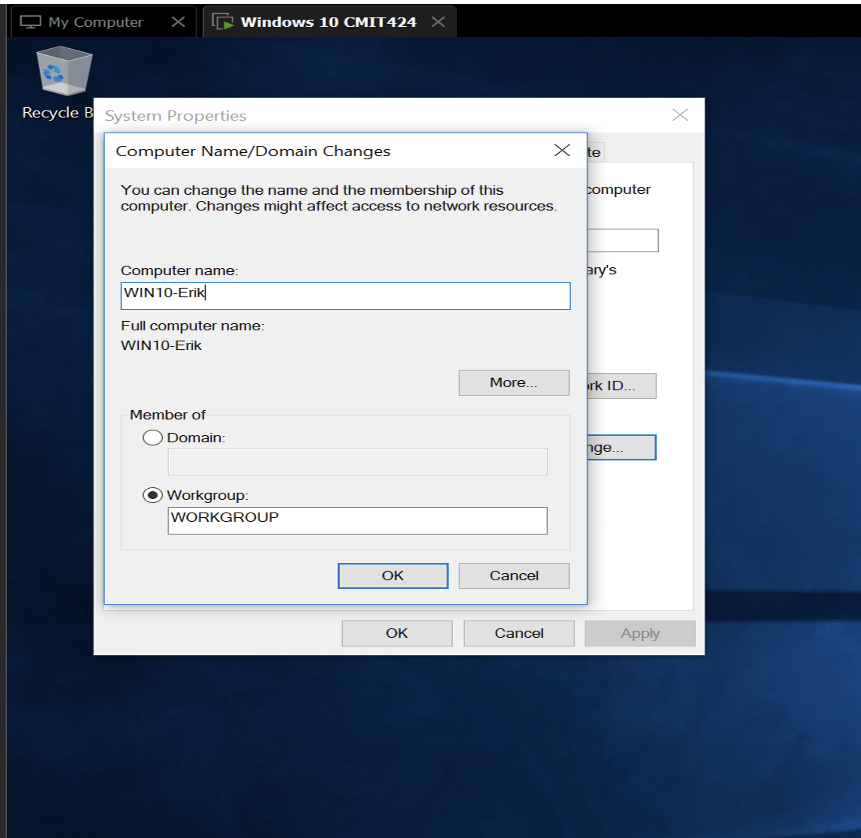
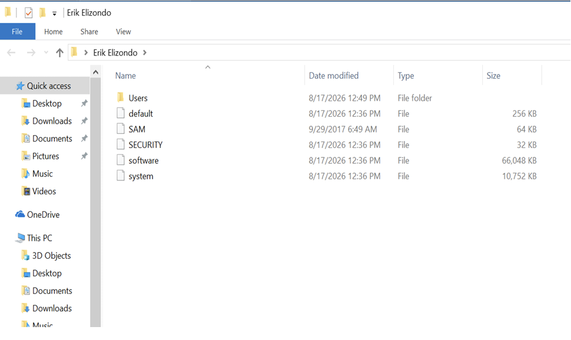
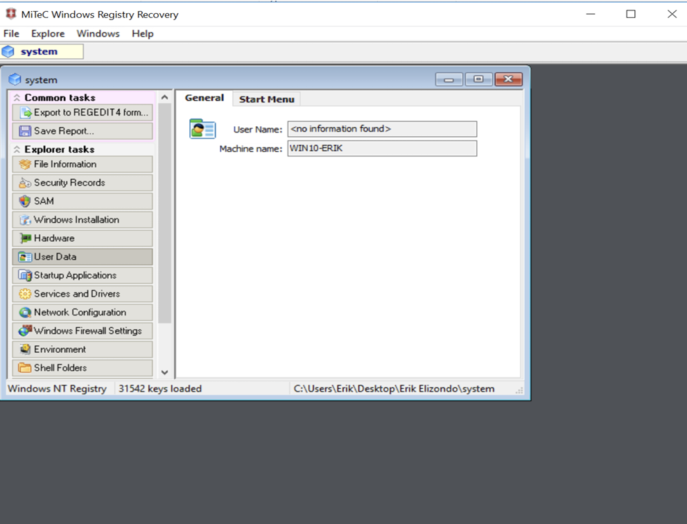
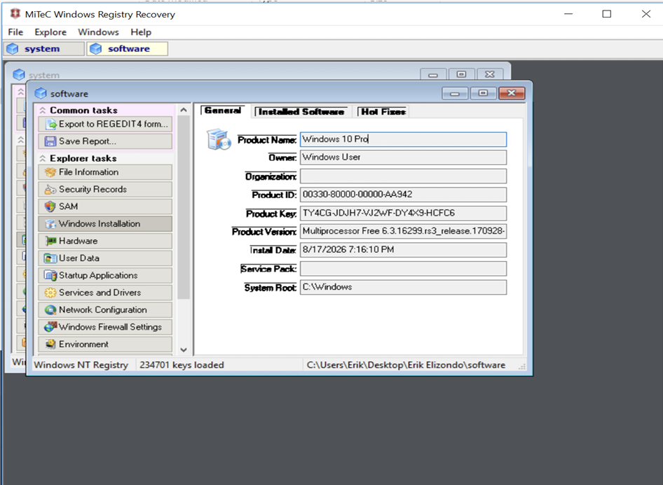
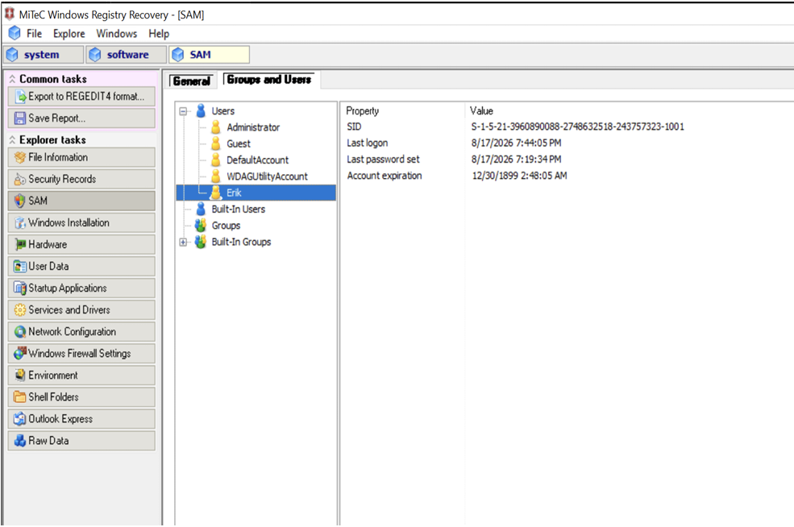

# Windows Registry Analysis

## Overview

This investigation examines the Windows Registry as a source of forensic information about a system and its users.

Registry data was collected and examined within a controlled Windows environment to identify system information, Windows installation metadata, and user account information stored within registry hives.

The investigation demonstrates how registry artifacts can provide persistent information about a Windows installation and contribute context to a broader forensic examination.

---

## Objectives

- Identify the system being examined
- Export Windows Registry hives for analysis
- Examine registry data outside the live Registry Editor
- Identify system information contained within registry artifacts
- Examine Windows installation metadata
- Review user account information stored within the SAM hive
- Practice interpreting registry artifacts as forensic evidence

---

## Environment & Tools

This investigation was performed in a controlled Windows lab environment using:

- Windows Registry artifacts
- Windows Registry Recovery
- Windows file-system utilities
- Windows command-line utilities

---

# Phase 1: System Identification

## 1. System Identification

The Windows system was identified before registry artifacts were collected and examined.

*Figure 1. System identification prior to registry analysis.*

Documenting the source system provides context for artifacts collected during the investigation and helps associate subsequent findings with the environment being examined.

---

# Phase 2: Registry Collection

## 2. Registry Hive Export

Registry hive data was exported from the Windows environment for subsequent examination.

*Figure 2. Exported Windows Registry hive data prepared for analysis.*

Separating collected registry data from the live environment allows the artifacts to be examined as evidence rather than relying exclusively on the active system configuration.

---

# Phase 3: System Artifact Analysis

## 3. Machine Information

The collected registry data was examined for information associated with the Windows system.

*Figure 3. Machine information identified during registry examination.*

System-level registry artifacts can provide additional context about the Windows installation represented by the collected hives.

---

## 4. Windows Installation Metadata

Registry information associated with the Windows installation was examined.

*Figure 4. Windows installation metadata identified within the registry data.*

Installation metadata can provide useful system context that may later be correlated with other host-based evidence.

---

# Phase 4: User Account Analysis

## 5. SAM Examination

The Security Account Manager (SAM) registry hive was examined for locally stored user account information.

*Figure 5. User account information examined within the SAM registry data.*

User-related registry artifacts can help establish which local accounts are represented on a Windows system and provide another source of information for comparison with event logs and other forensic artifacts.

---

# Findings

The investigation demonstrated that Windows Registry artifacts can provide persistent information about both the operating system and locally represented user accounts.

Key observations included:

- Registry hive data could be collected for separate examination.
- System information could be identified from the collected registry artifacts.
- Windows installation metadata was available within the registry data.
- The SAM hive contained information associated with local user accounts.
- Registry findings can provide context that may be correlated with other Windows forensic evidence.

---

# Investigative Takeaways

This investigation demonstrated that the Windows Registry is more than a configuration database. From a forensic perspective, registry hives can act as structured sources of system and user information.

The exercise also reinforced the value of examining artifacts outside the live environment. Rather than relying solely on what Windows currently presents through its graphical interfaces, collected registry data can be preserved and analyzed separately.

Most importantly, registry evidence gains additional value through correlation. System information, account artifacts, installation metadata, event logs, file-system activity, and other evidence sources can be compared to produce a more complete picture of a Windows system.

As with other forensic artifacts, registry information should provide evidence for a conclusion rather than become a conclusion by itself.

---

# Workflow

**Identify → Collect → Examine → Correlate → Document**

---

# Skills Demonstrated

- Windows Registry analysis
- Registry hive collection
- Offline registry examination
- Windows system artifact identification
- Windows installation metadata analysis
- SAM analysis
- Local user account analysis
- Artifact correlation
- Forensic documentation

---

## Related Investigations

[← Back to ResidualEvidence](../../README.md)

